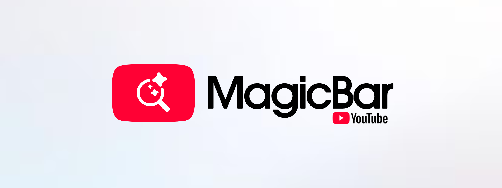
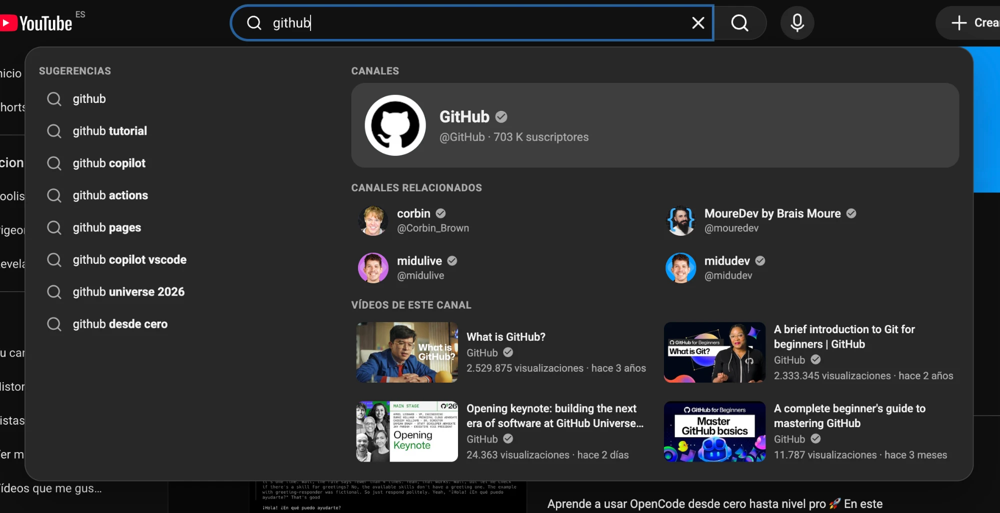
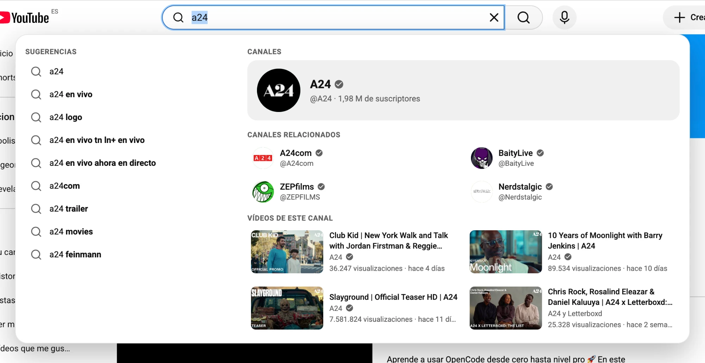

# MagicBar for YouTube _(Chrome, Brave, Edge, other Chromium browsers and Safari)_

[](docs/banner.png)

**MagicBar turns the YouTube search bar into a complete, personal search panel.** Click the bar and you get your recent searches, the latest videos from the channels you follow, your watch history and the channels you watch the most. Start typing and the panel reads your intent: it shows live suggestions on the left, and on the right the matching channel (avatar, verified badge, `@handle`, subscribers), related accounts and the most relevant videos.

It replaces YouTube's native suggestions dropdown and works with your own account, directly inside `youtube.com`. No servers, no tracking.

[](docs/screenshot-channel-dark.png)
[](docs/screenshot-channel-light.png)

## ✨ Features

### When you click the bar (empty search)

Three columns with your own data:

| Column | Content |
| --- | --- |
| **Recent searches** | Your last 10 entries, newest first. Searches and accounts you opened from a search live in the same list. |
| **From people you follow** | The latest videos from your subscriptions feed, with a _See more_ pill linking to `/feed/subscriptions`. |
| **Your history** | Your last 2 watched videos plus the **4 channels you watch the most**, with their real avatar, subscribers and total number of videos. _See more_ pills link to `/feed/history` and `/feed/channels`. |

### When you type (search intent system)

MagicBar detects what you are looking for and reorders the panel accordingly:

| Intent | Example | What you see first |
| --- | --- | --- |
| Very short query (1-2 chars) | `mi` | Recent searches that match + suggestions. No network noise. |
| Channel | `midudev`, `@midudev`, `minudev` (typos are tolerated) | A large featured channel card, related channels, then the channel's videos. |
| Channel + topic | `midudev react` | The channel, its videos about the topic, then other videos. |
| Specific topic / video | `how to build a login with react` | Videos first (up to 6), then related channels. |
| Broad topic | `react` | Suggestions, popular videos, featured channels. |

Left side: live YouTube suggestions and matches from your own history. Right side: real YouTube search results, ranked with your context (channels you follow get a boost and a **Subscribed** tag).

### Details that matter

- **Verified badge** next to official channels and on the channels of videos.
- **Official channels without impostors.** When the top channel is verified, look-alike accounts are hidden. Instead you get **related channels**: the channel's own _featured channels_ (e.g. `MrBeast` → `Beast Philanthropy`, `MrBeast Gaming`) or, if it has none, the verified channels that appear in the results.
- **Unified history.** Searches show a magnifier icon. When you search and then click an **account** instead of pressing Enter, it is saved in the history with the user icon and its `@handle` (plus the verified badge).
- **Search trends.** A green _trending-up_ or red _trending-down_ icon appears next to searches that are (or recently stopped being) in Google Trends for your country.
- **Row actions** on hover: use in the search box, **copy** the text, remove from history.
- **Real channel data.** Avatar, `@handle`, subscribers and number of videos come from each channel's own page, not from guesses.
- **Keyboard**: `↑` `↓` to move through every item, `Enter` to open/search, `Esc` to close.
- **Opens only where it should**: click inside the bar (or type in it). It closes on Enter, on the search button, on a click outside, on `Esc` and when you leave the field.
- **Skeleton loaders and stale-while-loading**: the panel is never empty; previous results stay dimmed while new ones arrive, with a thin progress bar.
- **Dark and light mode**: follows YouTube's theme automatically and switches live.
- **21 languages**: the panel adapts to YouTube's interface language, including relative dates and right-to-left layouts. Supported: English, Spanish, Portuguese, French, German, Italian, Dutch, Polish, Russian, Ukrainian, Turkish, Swedish, Indonesian, Vietnamese, Thai, Japanese, Korean, Chinese, Arabic, Hebrew and Hindi. Any other language falls back to English.
- **Fully replaces YouTube's native dropdown** (suggestions and history), while still reading your account's recent searches from it.

## 🧠 How it gets your data

MagicBar reads your account with **your own signed-in session**, from inside `youtube.com`. It does not use any API key and it does not ask for your credentials.

| Data | Source |
| --- | --- |
| Recent searches | YouTube's own search box list, plus every search you make while using the extension |
| Watched videos | `/feed/history` (first pages) plus every video you watch |
| Channels you follow | `/feed/channels` and `/feed/subscriptions` |
| Channel identity (name, handle, avatar, subscribers, videos, verification) | YouTube's internal `youtubei` API, same as the website |
| Live search results | YouTube's search API (`youtubei/v1/search`), with the HTML results page as a fallback |
| Text suggestions | `suggestqueries.google.com` |
| Search trends | Google Trends public RSS feed (`trends.google.com/trending/rss`) for your country |

## 🔒 Privacy

- Everything is stored **locally** in your browser (`chrome.storage.local`).
- There are **no analytics, no remote servers and no third-party services** besides the YouTube and Google endpoints listed above, which are queried directly from your browser.
- You can wipe the data at any time by removing the extension or clearing its storage.

## 🔑 Permissions

| Permission | Why |
| --- | --- |
| `storage` | Keeps your history, visited accounts and cached channel data on your device. |
| `https://www.youtube.com/*` | Runs on YouTube and reads your own feeds. |
| `https://suggestqueries.google.com/*` | Live text suggestions. |
| `https://trends.google.com/*` | Trending indicators. |

## 📦 Installation

### Chrome, Brave, Edge and other Chromium browsers (developer mode)

1. Download or clone this repository.
2. Open `chrome://extensions` and enable **Developer mode**.
3. Click **Load unpacked** and select the [`magicbar`](magicbar) folder.
4. Open [youtube.com](https://www.youtube.com), click the search bar and enjoy.

> After reloading the extension, also reload your YouTube tabs. Tabs that were open keep an old copy of the extension that can no longer save data.

### Safari (macOS)

Safari loads web extensions through a small app wrapper. You do **not** need Xcode: the Command Line Tools (`xcode-select --install`) are enough.

1. Build and install the app:

   ```bash
   ./safari/build-clt.sh
   cp -R "safari/build/MagicBar for YouTube.app" ~/Applications/
   open ~/Applications/"MagicBar for YouTube.app"
   ```

2. In Safari, enable **Develop > Allow Unsigned Extensions** (turn on the Develop menu in Settings > Advanced first). Safari asks for this again after every restart, because the app is ad-hoc signed.
3. Open **Settings > Extensions**, enable **MagicBar for YouTube** and allow it on `youtube.com`, `suggestqueries.google.com` and `trends.google.com`.

If you do have Xcode, `./safari/build.sh` generates a regular Xcode project instead.

`content.js` and `background.js` are shared by both browsers. Only `safari/manifest.json` differs: Safari uses a non-persistent background script instead of a service worker.

## 🗂 Project structure

```
.
├── docs/                    # Banner and screenshots
├── magicbar/                # The extension (load this folder)
│   ├── manifest.json        # Manifest V3
│   ├── content.js           # Panel UI, intent engine, history, data sync
│   ├── background.js        # Service worker: suggestions and trends (CORS-free fetch)
│   ├── icons/               # 16/32/48/128 px icons + logo.svg
│   └── dev/                 # Local demo harness with mocked YouTube responses
├── safari/                  # Safari version
│   ├── manifest.json        # Safari manifest (non-persistent background script)
│   ├── build-clt.sh         # Builds the Safari app with the Command Line Tools only
│   ├── build.sh             # Alternative: generates an Xcode project (needs Xcode)
│   └── src/                 # Swift wrapper app and extension handler
├── LICENSE
└── README.md
```

## 🧪 Local demo

`magicbar/dev` contains a harness that loads `content.js` on a fake YouTube header with mocked storage and mocked `youtubei` responses, so you can work on the UI without touching your account:

```bash
cd magicbar
python3 -m http.server 8765
# open http://localhost:8765/dev/index.html and click the search bar
```

## ⚠️ Known limitations

- YouTube does not expose your search history through any page or API. MagicBar reads it from the native dropdown and from what you search while the extension is installed, so it starts small and grows with use.
- The _trending-down_ indicator needs a few days of readings: Google only publishes what is trending now, and a drop is detected by comparing readings over time. Only ~10 terms per country are published, so most searches will have no indicator.
- "Most watched channels" are computed from the portion of your history that YouTube returns (the most recent entries), not your lifetime history.
- On Safari, permissions are granted by the user in Settings > Extensions, and the app is built locally and ad-hoc signed; no prebuilt app is distributed.
- YouTube changes its internal structures from time to time. If a section stops filling, please open an issue.

## 👨‍💻 Development

Contributions are welcome through GitHub.

[](https://github.com/pigeonposse/magicbar-youtube/issues)
[](https://github.com/pigeonposse/magicbar-youtube/pulls)

## ☕ Donate

If MagicBar saves you time, you can support the project.

[](https://pigeonposse.com)

## 📜 License

This project is licensed under the **GNU General Public License v3.0**.

[](LICENSE)

## 🐦 About us

PigeonPosse is a code development collective. MagicBar is an independent project and is not affiliated with, endorsed by or sponsored by YouTube or Google. YouTube is a trademark of Google LLC.

### Collaborators

| Name | Role | GitHub |
| --- | --- | --- |
| Alejo | Author, Design & Development | [@AlejoMalia](https://github.com/AlejoMalia) |
| PigeonPosse | Collective | [@pigeonposse](https://github.com/pigeonposse) |
